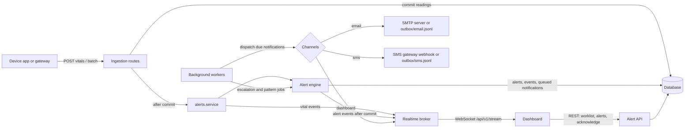

# HealthTrack Alert System: Integration Guide

This guide explains how the Phase 4 alert system connects to the rest of HealthTrack and how another component
(a device gateway, the dashboard, an email or SMS provider, an operations tool) plugs into it. It covers the data
flow, every integration point with its contract, configuration, and a smoke test. All example payloads below were
captured from a real run against the seed data; ids and timestamps will differ on your machine.

## 1. Architecture

The alert system lives inside the FastAPI service, next to the Phase 3 API, as separate modules behind defined
interfaces (requirement NFR-18):

| Module | Responsibility |
|---|---|
| `app/alerts/engine.py` | Threshold rules on each reading, pattern rules on history, alert fatigue controls, escalation |
| `app/alerts/patterns.py` | Trend and adherence metrics (missed sessions, zone minutes, resting heart rate, steps, data gap) |
| `app/alerts/notifications.py` | Notification payloads, channel adapters (dashboard, email, SMS), the outbox dispatcher, digests |
| `app/alerts/service.py` | Glue: called by ingestion after readings commit; publishes live events after alerts commit |
| `app/alerts/workers.py` | Background jobs started with the API: dispatch, escalation checks, pattern detection |
| `app/realtime/` | In-process publish/subscribe broker and one-time WebSocket tickets |
| `app/repositories/alerts.py` | All alert-table SQL; nothing else touches those tables directly |



Three rules hold the design together:

1. **Readings are never lost to an alert problem.** Ingestion commits the readings first. Alert evaluation runs
   afterward in its own transaction; if it fails, the failure is logged with the patient id and the request still
   succeeds (scenario AS-48).
2. **Nothing is shown that was rolled back.** Alert events are published to the broker only after the alert
   transaction commits.
3. **Notifications use an outbox.** The engine only writes `notifications` rows with status `queued`; a background
   worker sends them, retries failures, and records every delivery as a `notified` history event. A slow email
   server can never slow down ingestion.

## 2. Running the components

From `phase4-alert-system/` with the virtual environment active (setup is in the README):

```bash
python3 -m alembic upgrade head        # 0003_alerting adds the alert tables, 12 default rules, 4 policies
python3 -m scripts.seed                # sample patients, prescriptions, and an alert history
python3 -m uvicorn app.main:app        # api on :8000; the background workers start with it
python3 -m scripts.simulate_devices    # optional, second terminal: live device data, Thomas breaches at ~30 s
```

The workers run inside the API process (FastAPI lifespan). Set `HT_ALERT_WORKERS=0` to run the API without them,
for example on a read-only replica; the jobs can then be triggered through the job endpoint (section 7).

## 3. Integration point: reading ingestion (device gateways)

No new call is needed to get alerts. Every existing Phase 3 write path triggers evaluation:

| Endpoint | Triggers |
|---|---|
| `POST /api/v1/patients/{id}/vitals` | Threshold rules for that reading |
| `POST /api/v1/patients/{id}/vitals/batch` | Threshold rules for every new reading in the batch, in time order |
| `PUT /api/v1/patients/{id}/daily-activity/{date}` | Pattern rules for that patient (step and resting heart rate trends) |

Request (as the patient's device app):

```json
POST /api/v1/patients/00000000-0000-4000-b000-000000000005/vitals/batch
{
  "readings": [
    {"recorded_at": "2026-11-10T18:11:43+00:00", "context": "exercise", "heart_rate": 134,
     "device_id": "00000000-0000-4000-c000-000000000051", "idempotency_key": "hb2-5-0417-0000"},
    {"recorded_at": "2026-11-10T18:11:58+00:00", "context": "exercise", "heart_rate": 139,
     "device_id": "00000000-0000-4000-c000-000000000051", "idempotency_key": "hb2-5-0417-0001"}
  ]
}
```

Response: the Phase 3 batch result plus `alerts_raised`, the number of alerts created by this batch.

```json
{"accepted": 2, "duplicates": 0, "flagged_suspect": 0, "rejected": [], "alerts_raised": 1}
```

Gateway requirements:

- Send `context` correctly. Rules filter on it: the heart rate ceiling applies to `warmup`, `exercise`, and
  `cooldown`; resting rules apply only to `rest`.
- Always send an `idempotency_key` (8 to 64 characters, letters, digits, `._:-`). A replayed batch is counted as
  duplicates and never alerts twice.
- Suspect readings (implausible values) are stored but never alert (requirement FR-07), so a gateway does not need
  to filter artifacts itself.

## 4. Integration point: the live stream (dashboards)

### 4.1 Opening a connection

Browsers cannot put an `Authorization` header on a WebSocket, and a token in the URL would be written to proxy
logs. The dashboard server, which holds the access token, asks for a one-time ticket and gives only the ticket to
the browser:

```json
POST /api/v1/stream/ticket          (Authorization: Bearer <clinician or physician token>)
{"ticket": "wst_2b5ieiG_...", "expires_in": 60, "url": "ws://localhost:8000/api/v1/stream"}
```

A ticket works once and expires after 60 seconds. Non-browser clients may authenticate with
`{"type": "auth", "token": "<access token>"}` instead.

### 4.2 Protocol

All frames are JSON text. The first client frame must arrive within 10 seconds.

| Direction | Frame | Meaning |
|---|---|---|
| client to server | `{"type": "auth", "ticket": "wst_..."}` | Authenticate (first frame) |
| server to client | `{"type": "ready", "user_id", "role", "patients": [...], "server_time"}` | Authenticated; `patients` is the caller's care-team scope |
| client to server | `{"type": "subscribe", "patient_ids": ["..."]}` | Optional: reading events only for these patients; `[]` or `null` resets. Alerts still arrive for every patient in scope |
| server to client | `{"type": "vital", "patient_id", "data", "published_at"}` | A new reading was stored |
| server to client | `{"type": "alert", "action", "patient_id", "data", "published_at"}` | An alert was created, repeated, acknowledged, escalated, resolved, or suppressed (`action`) |
| server to client | `{"type": "activity", "patient_id", "data", "published_at"}` | A day of activity totals was uploaded |
| server to client | `{"type": "notification", "user_id", "data", "published_at"}` | A dashboard notification for this user only |
| server to client | `{"type": "ping"}` | Heartbeat every 20 seconds; the client may answer `{"type": "pong"}` |

Close codes: `4401` authentication failed, `4403` origin not allowed (the `Origin` header must be in
`HT_CORS_ORIGINS`), `1000` normal. Events are filtered by care team before they are queued, so a clinician never
receives another team's patient (scenario AS-44); care-team changes take effect within 60 seconds. A client that
falls more than 1,000 events behind loses its oldest events rather than slowing the API.

### 4.3 Event examples

The two readings above produced these frames on a connected clinician dashboard, in this order:

```json
{"type": "vital", "patient_id": "00000000-0000-4000-b000-000000000005",
 "data": {"vital_id": 1452, "recorded_at": "2026-11-10T18:11:58+00:00", "context": "exercise",
          "heart_rate": 139, "systolic_bp": null, "diastolic_bp": null, "spo2": null, "quality": "valid",
          "source": "device", "device_id": "00000000-0000-4000-c000-000000000051"},
 "published_at": "2026-11-10T18:12:13.231+00:00"}
```

```json
{"type": "alert", "action": "created", "patient_id": "00000000-0000-4000-b000-000000000005",
 "data": {"alert_id": "b0339152-4cd7-411e-a5ef-0eaee418d98c", "rule_code": "HR_ABOVE_CEILING",
          "rule_name": "Heart rate above prescribed ceiling", "rule_type": "threshold", "severity": "critical",
          "status": "open", "title": "Heart rate 139 bpm above prescribed limit of 128 bpm",
          "triggering_values": {"metric": "heart_rate", "values": [134, 139], "context": "exercise",
                                "recorded_at": "2026-11-10T18:11:58+00:00", "vital_id": 1452},
          "threshold_applied": 128.0, "threshold_source": "prescription", "occurrences": 1,
          "triggered_at": "2026-11-10T18:12:13.231798Z", "escalation_level": 0, "acknowledged_at": null,
          "...": "remaining AlertOut fields"},
 "published_at": "2026-11-10T18:12:13.248+00:00"}
```

The `notification` frame carries the notification payload described in section 6.1 plus a `subject`.

### 4.4 Starting state

A dashboard loads its starting state over REST, then applies events:

- `GET /api/v1/monitoring/worklist`: one row per active or paused patient on the caller's team, with the latest
  valid values, active alert counts by severity, the top alert, a `priority` (4 critical to 0 none), and the
  prescription zone. Already sorted critical first.
- `GET /api/v1/patients/{id}/alert-thresholds`: the threshold actually applied for each rule and its `source`
  (`override`, `prescription`, or `default`), used to draw threshold lines and color readings.
- `GET /api/v1/patients/{id}/vitals`, `/vitals/latest`, `/vitals/daily-summary`, `/daily-activity`: Phase 3
  endpoints for chart history.

## 5. Integration point: alert management API

All routes are under `/api/v1` and return RFC 9457 problem details on error. Clinicians and physicians see only
patients on their current care team; an alert outside that scope returns 404.

| Method and path | Roles | Purpose |
|---|---|---|
| `GET /alerts` | clinician, physician | Active worklist by default (open, acknowledged, escalated by priority). Filters: `patient_id`, `severity`, `status`, `rule_code`, `start`, `end`, `acknowledged_by`, `escalated`, `sort`, `page`, `page_size`. Repeat a parameter to match several values |
| `GET /alerts/{id}` | clinician, physician | Alert detail with `events` (append-only history), `notifications` (each delivery with status and attempts), and `timeline` (minutes to acknowledge and resolve) |
| `POST /alerts/{id}/acknowledge` | clinician, physician | Body `{"note": "..."}` (optional). Records who and when; stops escalation |
| `POST /alerts/{id}/resolve` | clinician, physician | Body `{"note": "..."}` (required, at least 3 characters). Records the acknowledgment too if it was missing |
| `POST /alerts/{id}/comments` | clinician, physician | Adds a comment event to the history |
| `GET /alerts/metrics` | clinician, physician (their team), admin (whole program) | Counts by severity and status, escalations, repeats absorbed, minutes to acknowledge and resolve (median, 90th percentile, max), and notification delivery counts; defaults to the last 7 days |
| `POST /alerts/jobs/{patterns,escalations,dispatch}` | admin, IT admin | Run a background job now |

Patients and administrators receive 403 on acknowledge and resolve (requirement FR-14). Every state change writes
an `alert_events` row and an audit-log entry. The history from the example above:

```json
"events": [
  {"event_type": "created", "to_status": "open", "actor_user_id": null,
   "payload": {"threshold": 128.0, "threshold_source": "prescription"}},
  {"event_type": "notified", "payload": {"channel": "dashboard", "recipient_user_id": "...a000-000000000002", "level": 0}},
  {"event_type": "notified", "payload": {"channel": "sms", "recipient_user_id": "...a000-000000000002", "level": 0}},
  {"event_type": "notified", "payload": {"channel": "email", "recipient_user_id": "...a000-000000000002", "level": 0}},
  {"event_type": "acknowledged", "from_status": "open", "to_status": "acknowledged",
   "actor_user_id": "...a000-000000000002", "note": "Called patient; stopped session, resting now.",
   "payload": {"minutes_to_acknowledge": 0.0, "escalation_level": 0}}
]
```

Configuration endpoints (thresholds, rules, prescriptions, escalation policies) are described with their roles and
validation in the alert configuration document, `docs/HealthTrack_Alert_Configuration.pdf`.

## 6. Integration point: notification channels

### 6.1 Payload

Every notification row stores the full payload. Its schema is versioned as `healthtrack.alert-notification/1`:

```json
{
  "schema": "healthtrack.alert-notification/1",
  "alert_id": "b0339152-4cd7-411e-a5ef-0eaee418d98c",
  "patient_id": "00000000-0000-4000-b000-000000000005",
  "severity": "critical",
  "rule_code": "HR_ABOVE_CEILING",
  "rule_name": "Heart rate above prescribed ceiling",
  "title": "Heart rate 139 bpm above prescribed limit of 128 bpm",
  "status": "open",
  "triggering_values": {"metric": "heart_rate", "values": [134, 139], "context": "exercise",
                        "recorded_at": "2026-11-10T18:11:58+00:00", "vital_id": 1452},
  "threshold_applied": 128.0,
  "threshold_source": "prescription",
  "triggered_at": "2026-11-10T18:12:13.231798+00:00",
  "escalation_level": 0,
  "links": {"dashboard": "http://localhost:8050/?alert=b0339152-4cd7-411e-a5ef-0eaee418d98c",
            "api": "/api/v1/alerts/b0339152-4cd7-411e-a5ef-0eaee418d98c"}
}
```

The dashboard channel is authenticated and scoped to the care team, so it receives this payload in full. Email and
SMS are not secure channels, so their text follows the HIPAA minimum-necessary standard: severity, rule name, and a
link that requires sign-in. No patient name, MRN, or measured value is sent (scenario AS-24). The captured
messages for the example alert:

```json
{"to": "marcus.lee@healthtrack.example",
 "subject": "HealthTrack CRITICAL alert: Heart rate above prescribed ceiling",
 "body": "HealthTrack CRITICAL alert: Heart rate above prescribed ceiling.\nA patient on your care team needs review. Sign in to view and acknowledge:\nhttp://localhost:8050/?alert=b0339152-...\nThis message contains no patient details. Do not reply."}
{"to": "+17195550102",
 "text": "HealthTrack CRITICAL alert: Heart rate above prescribed ceiling. Review: http://localhost:8050/?alert=b0339152-..."}
```

### 6.2 Connecting a real provider

| Channel | Default (development) | Production setting | Contract |
|---|---|---|---|
| Dashboard | Always on | None | `notification` frame to the recipient's open sessions; also listed in the alert detail |
| Email | Appends to `outbox/email.jsonl` | `HT_SMTP_HOST`, `HT_SMTP_PORT`, `HT_SMTP_FROM` | SMTP with STARTTLS; one message per notification, or one digest per recipient per day |
| SMS | Appends to `outbox/sms.jsonl` | `HT_SMS_WEBHOOK_URL` | `POST` JSON `{"to": "+1...", "text": "..."}` (text up to 320 characters); any 2xx is success |

The SMS contract is deliberately small so any provider (Twilio, Amazon SNS, a hospital paging system) can sit
behind a short adapter service. A recipient with no phone number on file is not sent SMS (the other channels still go out),
and a gateway error is recorded as a failed delivery with its reason.

### 6.3 Delivery behavior

- Order: critical notifications are sent before lower-priority ones queued earlier (scenario AS-23).
- Retries: a failed send is retried after 15 seconds, then 30 seconds, and marked `failed` with a reason after 3
  attempts, without blocking other channels (scenario AS-26).
- Digest: low-severity email is held until `HT_DIGEST_HOUR` (program time zone) and grouped into one message per
  recipient. During an alert storm (more than `HT_ALERT_STORM_CAP` non-critical alerts for one patient in an hour),
  that patient's non-critical email and SMS also go to the digest; the dashboard is still notified immediately.
- Latency: the engine wakes the dispatcher the moment it queues a notification, so messages leave within
  milliseconds; a 2-second poll (`HT_DISPATCH_POLL_SECONDS`) is the fallback.

### 6.4 Adding a channel

1. Add the value to `NotificationChannel` in `app/models/enums.py` and add a migration that extends the enum.
2. Write a class with `channel` and `send(recipient, subject, body, payload) -> bool` (the `Channel` protocol in
   `app/alerts/notifications.py`). Return `True` only when delivery is confirmed; raise `DeliveryError` on
   failure so the dispatcher retries.
3. Register it in `default_channels()` and add it to the escalation policies that should use it
   (`PUT /api/v1/escalation-policies/{severity}`).

## 7. Background jobs

| Job | Default schedule | What it does |
|---|---|---|
| `dispatch` | On wake-up, with a 2-second fallback poll | Sends due notifications and digests |
| `escalations` | Every 30 s (`HT_ESCALATION_CHECK_SECONDS`) | Raises unacknowledged alerts past their policy timeout one level and notifies the next recipients |
| `patterns` | Every 15 min (`HT_PATTERN_CHECK_MINUTES`) | Missed sessions, zone minutes, resting heart rate, steps, and data-gap rules for every active patient |

Jobs run in worker threads so the event loop keeps serving WebSocket clients. A failed run is logged and retried
on the next cycle. `POST /api/v1/alerts/jobs/{job}` (admin or IT admin) runs any job immediately.

## 8. Configuration reference

| Variable | Default | Purpose |
|---|---|---|
| `HT_ALERT_WORKERS` | `1` | Start the background jobs with the API |
| `HT_DISPATCH_POLL_SECONDS` | `2` | Fallback poll for queued notifications |
| `HT_ESCALATION_CHECK_SECONDS` | `30` | Escalation check interval |
| `HT_PATTERN_CHECK_MINUTES` | `15` | Pattern detection interval |
| `HT_DIGEST_HOUR` | `7` | Local hour the daily digest is sent |
| `HT_PROGRAM_TIMEZONE` | `America/Denver` | Time zone for the digest hour |
| `HT_ALERT_STORM_CAP` | `4` | Non-critical alerts per patient per hour before email and SMS move to the digest |
| `HT_DASHBOARD_URL` | `http://localhost:8050` | Base of the sign-in link in notifications |
| `HT_CORS_ORIGINS` | `http://localhost:8050,http://127.0.0.1:8050` | Allowed browser origins for REST and the WebSocket |
| `HT_OUTBOX_DIR` | `./outbox` | Where email and SMS are written when no provider is configured |
| `HT_SMTP_HOST`, `HT_SMTP_PORT`, `HT_SMTP_FROM` | unset, `587`, `alerts@healthtrack.example` | SMTP delivery |
| `HT_SMS_WEBHOOK_URL` | unset | SMS gateway endpoint |

`.env.example` lists every variable with comments.

## 9. Smoke test

With the API running and seeded, this confirms the whole path in about a minute:

1. In Swagger (`http://localhost:8000/docs`), sign in as `marcus.lee@healthtrack.example` and call
   `GET /monitoring/worklist`; Thomas Reed appears with his prescription (ceiling 128 bpm).
2. Start `python3 -m scripts.simulate_devices`. Within about 30 seconds Thomas's heart rate crosses 128 on two
   readings.
3. Call `GET /alerts`: a critical `HR_ABOVE_CEILING` alert is first. `outbox/sms.jsonl` and `outbox/email.jsonl`
   each have a new line with no patient details.
4. Call `POST /alerts/{id}/acknowledge`, then `GET /alerts/{id}`: the history shows created, three notified
   events, and acknowledged with your user id.
5. Leave an alert unacknowledged for 15 minutes (or set `HT_ESCALATION_CHECK_SECONDS=5` and lower the critical
   timeout with `PUT /escalation-policies/critical`) to watch it escalate to the supervising physician.

## 10. Limits and next steps

- The broker is in-process, so the API must run as a single process. Several workers or hosts need a shared bus
  (for example Redis publish/subscribe) behind the same `broker.publish()` interface.
- The email and SMS adapters are complete but were exercised against the outbox, not a live provider.
- Symptom reports (rules `SYMPTOM_CHEST_PAIN` and `SYMPTOM_REPORTED` in the Phase 2 design) are not yet collected
  by the API, so those rules are not loaded.
