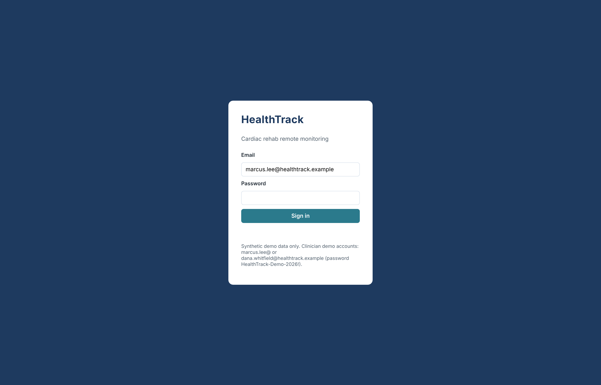
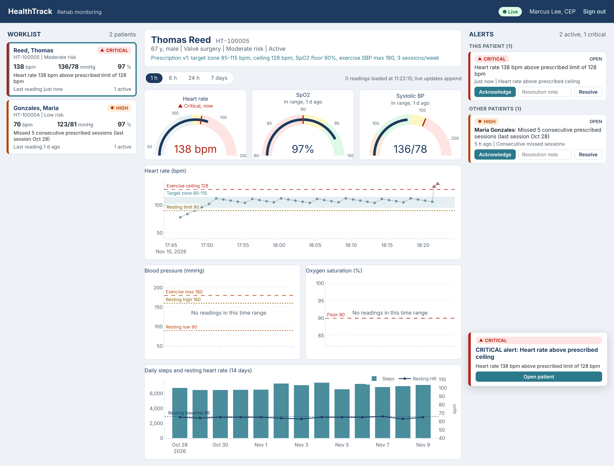
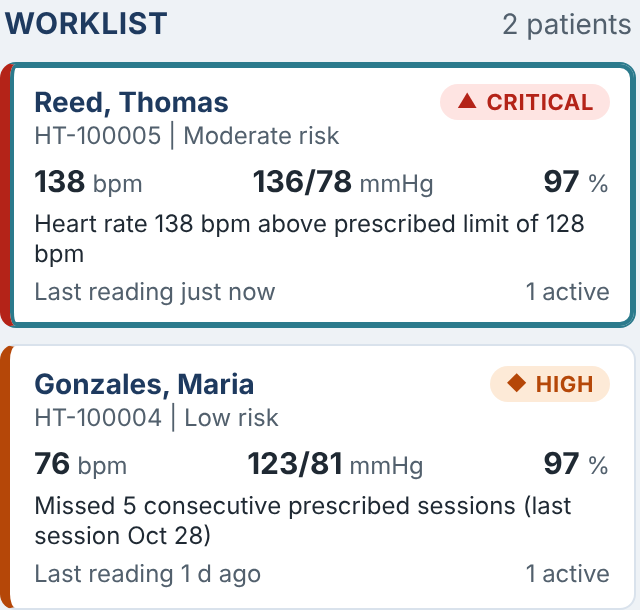
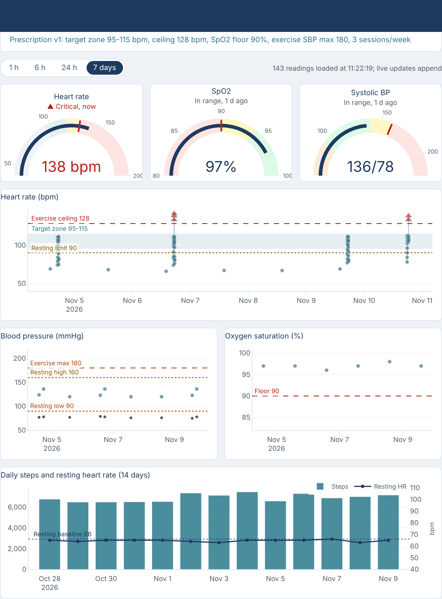
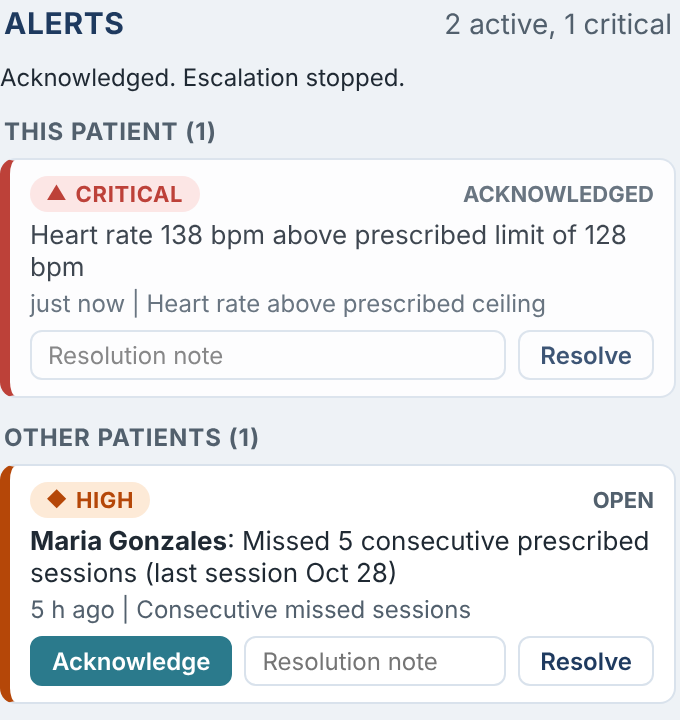

# HealthTrack Monitoring Dashboard: User Guide

This guide is for rehab clinicians and supervising physicians who use the HealthTrack dashboard to watch patients
exercising at home. It explains what each part of the screen shows, how to respond to an alert, and what to do when
something looks wrong. The screenshots use the synthetic sample data.

## 1. Signing in

Open the dashboard address your program gives you (on a development machine, `http://localhost:8050`) and sign in
with your HealthTrack email and password.

- The dashboard is for clinicians and physicians. Patient, administrator, and IT accounts are refused.
- After five wrong passwords the account locks for 15 minutes. Wait, or ask an administrator.
- A link in an alert email or text message opens that alert's patient as soon as you sign in.
- Use **Sign out** (top right) when you leave a shared computer. Patient data is never stored in the browser cache.

## 2. The screen at a glance

| Area | What it shows |
|---|---|
| **Header** (top) | The connection status pill, your name, and Sign out. **Live** means new readings arrive on their own. |
| **Worklist** (left) | Every active or paused patient on your care team, most urgent first. |
| **Patient view** (center) | The selected patient's details, prescription, current readings (gauges), and trend charts. |
| **Alerts** (right) | Active alerts for the selected patient first, then for your other patients, with actions. |
| **Pop-up notifications** (bottom right) | A new alert, or an escalation, addressed to you. |

## 3. Colors, symbols, and labels

Every status uses a color, a symbol, and a word, so nothing depends on color alone.

| Label | Symbol | Color | Meaning |
|---|---|---|---|
| Critical | ▲ | Red | Act now (for example heart rate above the prescribed ceiling during exercise) |
| High | ◆ | Orange | Review soon (for example missed sessions, high exercise blood pressure) |
| Moderate | ● | Amber | Review today (for example resting heart rate trending up) |
| Low | ○ | Gray | Informational (for example no data for 48 hours) |
| Stable | ✓ | Green | No active alerts |

On the charts, a normal reading is a small teal dot. An abnormal reading is larger and takes the severity symbol and
color: a red triangle for critical, an orange diamond for high, an amber square for moderate. A gray **x** is a
suspect reading (a physically unlikely value, such as a motion artifact); it is shown but never raises an alert.
Hover over any point to see its value, time, and exercise context.

## 4. The worklist

Patients are ranked by their most severe active alert, then by the newest alert, so the patient who needs you
first is always at the top. Each card shows:

- Name, MRN, clinical risk category, and "paused" if the patient has paused the program
- The latest valid heart rate, blood pressure, and SpO2
- The highest-priority alert, or "No active alerts"
- How long since the last reading, and the number of active alerts

When a new alert arrives the card changes color and moves up immediately. Click a card to open that patient.

## 5. The patient view

The header shows age, sex, qualifying event, risk category, and program status, followed by the current exercise
prescription (target heart rate zone, heart rate ceiling, SpO2 floor, exercise systolic limit, and sessions per
week). If the patient has no prescription, the program defaults apply and the header says so.

**Time range.** The buttons above the gauges choose 1 hour, 6 hours (the default), 24 hours, or 7 days. Live
readings keep arriving in any range. The 7-day view thins long stretches of normal readings to keep the charts
fast, but every abnormal reading and every high and low point is kept.

**Gauges.** Heart rate, SpO2, and systolic blood pressure show the latest valid reading against this patient's
own limits. The line under the title says whether the value is in range or which severity it reaches, and how old
the reading is.

**Heart rate chart.** The shaded band is the prescribed target zone. The red dashed line is the exercise ceiling;
two readings above it in a row raise a critical alert. The amber dotted line is the resting limit. Gaps in the line
separate exercise sessions.

**Blood pressure chart.** Systolic and diastolic values, with the exercise maximum and the resting high and low
limits.

**Oxygen saturation chart.** SpO2 with the prescribed floor.

**Daily steps and resting heart rate.** The last 14 days of steps (bars) and resting heart rate (line, right
axis), with the resting baseline from the prescription. A falling step count or a rising resting heart rate is
what the trend alerts watch for.

Every line and band on the charts comes from the limits the alert system actually applies to this patient, so if a
physician changes the prescription or sets an override, the charts change with it.

## 6. Responding to an alert

Each alert shows its severity, its status (Open, Acknowledged, or Escalated), what happened, how long ago, and
the rule that fired. For other patients the name comes first. "2 occurrences" means the condition happened again
while the alert was open; repeats are folded into the same alert rather than notifying you again.

1. **Acknowledge** when you take ownership. This records your name and the time and stops escalation. The alert
   stays on the list until it is resolved.
2. **Resolve** when the situation is handled. Type a short note first (for example "HR back to 104 after 5 min
   rest; no symptoms"); the dashboard asks for one if the box is empty. Resolving also records the acknowledgment
   if nobody acknowledged first.

If nobody acknowledges a critical alert within 15 minutes it escalates to the supervising physician, and at 30
minutes to the whole care team on every channel. The status changes to Escalated and the level is shown. A
confirmation line under the Alerts heading reports each action, and an error (for example, an alert another
clinician already resolved) is shown there in red.

## 7. Pop-up notifications

A pop-up appears at the bottom right when an alert is sent to you: a new alert for one of your patients, or an
escalation that reaches you. **Open patient** selects that patient. At most three pop-ups show at a time, an
escalation replaces the earlier pop-up for the same alert, and a pop-up closes when its alert is acknowledged or
resolved, or after 90 seconds. The alert itself stays in the Alerts panel until it is resolved.

Email and text messages carry only the severity, the rule name, and a sign-in link, never the patient's name or
values, so check the dashboard for details.

## 8. Live updates and the connection pill

| Pill | Meaning |
|---|---|
| **● Live** | Connected. New readings are drawn on the open charts and alerts appear within a second. |
| **○ Reconnecting (polling every 15 s)** | The live connection dropped (network change, server restart). The dashboard retries automatically (after 1 s, then 2 s, 4 s, up to 30 s) and refreshes the worklist, alerts, and charts every 15 seconds until it is back. |

You never need to reload the page. If you are signed out (for example your session expired), the dashboard returns
to the sign-in page.

## 9. Troubleshooting

| Problem | What to do |
|---|---|
| "Email or password is incorrect." | Check the address; passwords are case sensitive. |
| "Account locked after repeated failures" | Wait 15 minutes or ask an administrator to unlock it. |
| A patient you expect is missing | The worklist shows only active and paused patients on your current care team. Ask an administrator to check the care-team assignment. |
| A chart says "No readings in this time range" | Choose a longer range. The label disappears when a new reading arrives. |
| The pill stays on Reconnecting | The API may be down. Data still refreshes every 15 seconds while it retries; tell IT if it does not recover. |
| "Type a resolution note first." | Resolving needs a note of at least a few words. |
